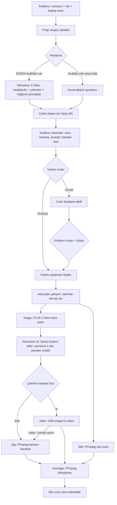
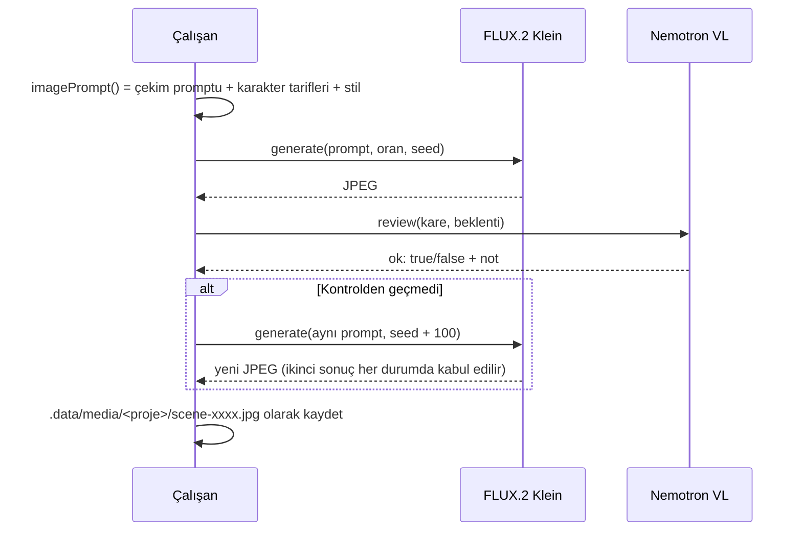

# Kadra Studio — Sistem Rehberi

> Senaryodan indirilebilir MP4 filme: sistem uçtan uca nasıl çalışır?
>
> Bu belge 22 Ekim 2026 tarihli kaynak koddan (`src/`) okunarak hazırlandı. Tasarım hedefleri için [docs/teknik-mimari.md](docs/teknik-mimari.md) ve [docs/gelistirme-plani.md](docs/gelistirme-plani.md) dosyalarına bakın. Bu belge ise **şu an kodda ne olduğunu** anlatır.
>
> **Sürüm notu (23 Ekim 2026):** Ücretsiz görsel üretimi (FLUX.2 Klein) ve FFmpeg kamera hareketi kaldırıldı. Yeni üretimde her kare ve her video GMI Cloud'un ücretli modelleriyle üretilir; FFmpeg yalnızca yazı kartı, ses/müzik miksajı ve montaj için kullanılır. Aşağıda "ücretsiz akış" diye geçen bölümler yalnızca eski projeler ve testler için geçerlidir.

---

## İçindekiler

1. [Tek cümlede sistem](#1-tek-cümlede-sistem)
2. [Kurulum ve çalıştırma](#2-kurulum-ve-çalıştırma)
3. [Büyük resim: akış şeması](#3-büyük-resim-akış-şeması)
4. [Aşama 1 — Proje oluşturma](#4-aşama-1--proje-oluşturma)
5. [Aşama 2 — Planlama (senaryo → çekimler)](#5-aşama-2--planlama-senaryo--çekimler)
6. [Aşama 3 — Üretim çalışması ve adımlar](#6-aşama-3--üretim-çalışması-ve-adımlar)
7. [Aşama 4 — Kare üretimi ve kalite kontrolü](#7-aşama-4--kare-üretimi-ve-kalite-kontrolü)
8. [Aşama 5 — Hareket: ücretsiz kamera ya da ücretli yapay zekâ videosu](#8-aşama-5--hareket-ücretsiz-kamera-ya-da-ücretli-yapay-zekâ-videosu)
9. [Aşama 6 — Yazı kartları ve montaj](#9-aşama-6--yazı-kartları-ve-montaj)
10. [Karakter tutarlılığı nasıl sağlanıyor?](#10-karakter-tutarlılığı-nasıl-sağlanıyor)
11. [Bütçe, teklif ve ödeme defteri](#11-bütçe-teklif-ve-ödeme-defteri)
12. [Hata kurtarma: neden hiçbir şey yarıda kalmaz?](#12-hata-kurtarma-neden-hiçbir-şey-yarıda-kalmaz)
13. [Veri saklama](#13-veri-saklama)
14. [API uç noktaları](#14-api-uç-noktaları)
15. [Kod haritası](#15-kod-haritası)
16. [Bilinen sınırlar ve eksikler](#16-bilinen-sınırlar-ve-eksikler)
17. [Örnek: "Balonlar ve Dağlar" projesini bu sisteme almak](#17-örnek-balonlar-ve-dağlar-projesini-bu-sisteme-almak)
18. [Sözlük](#18-sözlük)

---

## 1. Tek cümlede sistem

Kullanıcı bir senaryo yazar. Sistem senaryoyu **çekimlere** böler, her çekim için bir **başlangıç karesi** üretir ve bu kareyi bir yapay zekâ modeline **kontrol ettirir**. Ardından kareyi ya ücretsiz bir **kamera hareketiyle** ya da kullanıcı onaylarsa ücretli bir **yapay zekâ videosuyla** hareketlendirir. Yazı kartlarını çizer ve hepsini **tek bir MP4 film** olarak birleştirir.

Her şey kullanıcının kendi bilgisayarında çalışır (`127.0.0.1`). Ücretli bir işlem ancak kullanıcı fiyat teklifini açıkça onaylarsa yapılır.

---

## 2. Kurulum ve çalıştırma

### Gereksinimler

| Gereksinim | Neden |
| :--- | :--- |
| Node.js ≥ 22 | Next.js 16 ve `node:` modülleri |
| FFmpeg | Kamera hareketi, yazı kartı, müzik miksajı ve montaj (`brew install ffmpeg`) |
| `DEEPSEEK_API_KEY` (isteğe bağlı) | Modeller arası köprü: web arama (`/v1/tools/search`), karakter araştırma, senaryo planlama ve görsel hakemlik (`deepseek-flash`) |
| `NVIDIA_API_KEY` (ücretsiz, isteğe bağlı) | Senaryo planlama, ücretsiz FLUX.2 Klein kare/karakter üretimi ve Nemotron VL görsel hakemliği |
| `GMI_API_KEY` (ücretli, isteğe bağlı) | Fotoğraf referanslı karakter/sahne üretimi (Nano Banana 2.1) ve gerçek yapay zekâ videosu |

### Komutlar

```bash
npm install
cp .env.example .env.local      # anahtarları buraya yazın
npm run dev                     # http://127.0.0.1:3000
```

### Ortam değişkenleri (`.env.local`)

| Değişken | Varsayılan | Açıklama |
| :--- | :--- | :--- |
| `DEEPSEEK_API_KEY` | — | api.deepseek.com anahtarı. Varsa web araması, karakter araştırması, planlama ve görsel hakemlikte öncelikli köprü olarak kullanılır. |
| `NVIDIA_API_KEY` | — | build.nvidia.com ücretsiz anahtarı. Yoksa ücretsiz kareler yerine örnek görsel kullanılır; planlama DeepSeek veya yerel kurallarla yapılır. |
| `GMI_API_KEY` | — | GMI Cloud anahtarı. Yoksa fotoğraflı karakter sayfası, referanslı sahne karesi ve ücretli video seçenekleri kapalı kalır. |
| `KADRA_DATA_DIR` | `.data` | Proje verisi ve medya klasörü |
| `KADRA_WORKER` | (açık) | `off` yapılırsa üretim çalışanı web sunucusunda çalışmaz; ayrıca `npm run worker` başlatılır. |
| `FFMPEG_PATH` | otomatik | FFmpeg bulunamazsa tam yolu |
| `KADRA_TITLE_FONT` | sistem fontu | Yazı kartlarında kullanılacak font dosyası |

> [!IMPORTANT]
> Anahtarların başına asla `NEXT_PUBLIC_` eklemeyin. Eklenirse anahtar tarayıcıya sızar. Bütün sağlayıcı çağrıları sunucu tarafında yapılır.

### Kontroller

```bash
npm run typecheck   # TypeScript
npm run lint        # ESLint
npm test            # src/lib/**/*.test.ts (tsx --test)
npm run build       # üretim derlemesi
```

---

## 3. Büyük resim: akış şeması



---

## 4. Aşama 1 — Proje oluşturma ve Storyboard içe aktarma

Arayüzdeki **Yeni proje** penceresi ([new-project-dialog.tsx](src/components/new-project-dialog.tsx)) iki sekme sunar:

1. **Senaryodan oluştur:**
   - **Başlık** ve **senaryo metni**
   - **Stil** (ör. "Sinematik", "Anime", "Gerçekçi")
   - **Kadraj oranı:** `16:9`, `9:16` veya `1:1`
   - **Bütçe:** ücretli işlemler için üst sınır; boş bırakılırsa `null` ("Belirlenmedi") olarak kaydedilir. (`0` değeri yalnızca ilk açılışta gelen 3 örnek projede tanımlıdır.)
2. **Storyboard JSON yükle (`POST /api/projects/import`):**
   - `shots` dizisi içeren bir JSON dosyasını doğrudan `planned` durumunda içe aktarır (`planner: "import"`).
   - Her çekimin `id` (`code`), `sceneTitle`, `durationSec`, `visualSummary`, `cameraMovement`, `aiPrompt`, `voiceoverOrText` ve `audioNotes` alanlarını korur; ` pure black screen` veya yalnız tırnak içi metin olan çekimleri otomatik olarak `title` (yazı kartı) yapar.

İlk açılışta 3 örnek proje gelir: "Dağın Hafızası", "Son Işık" ve "Başka Bir Dünya" ([projects.ts](src/lib/projects.ts)).

**Proje durumları:** `draft` → `planned` → `producing` → `ready`

---

## 5. Aşama 2 — Planlama (senaryo → çekimler)

Planlama [planner.ts](src/lib/planner.ts), [providers/deepseek.ts](src/lib/providers/deepseek.ts) ve [providers/nvidia.ts](src/lib/providers/nvidia.ts) içinde yapılır. Üç kademeli zincir vardır:

### 5.1 Yapay zekâ planlayıcı (DeepSeek V4.1 Flash → Nemotron 3 Ultra)

- `DEEPSEEK_API_KEY` tanımlıysa senaryo önce DeepSeek köprüsüne (`deepseek-flash`, yedeği `deepseek-v4-pro`) gönderilir (`planner: "deepseek"`).
- DeepSeek tanımlı değilse veya hata verirse `NVIDIA_API_KEY` ile `nvidia/nemotron-3-ultra-550b-a55b` modeline geçilir (`planner: "nemotron"`).
- Model JSON döndürür ve bu JSON `zod` şemasıyla doğrulanır (`aiPlanSchema`). Dönen yapı:
  - **characters:** her karakter için `id`, `name` ve `appearance` (İngilizce dış görünüş tarifi)
  - **shots:** her çekim için `title`, `description`, `image_prompt` (İngilizce), `motion_prompt`, `camera`, `duration_seconds`, `kind` (`video` / `title`), `character_ids`, `narration` ve `on_screen_text`

`scenesFromAiPlan()` bu çıktıyı uygulamanın `Scene` tipine çevirir ve karakter kimliklerini `c1`, `c2`… biçiminde yeniden numaralar.

### 5.2 Kural tabanlı planlayıcı (yedek)

Anahtar yoksa ya da model hata verirse `planScenes()` devreye girer.

**Senaryoyu bölme kuralı (`parseScript`):**

1. Satır başında şu etiketlerden biri varsa yeni çekim başlar: `Sahne 3`, `3. Sahne`, `İlk sahne`, `Giriş`, `Intro`, `Final`, `Son sahne`. Başına `#` konabilir, sonuna `– alt başlık:` eklenebilir.
2. Hiç etiket yoksa her **boş satırla ayrılmış paragraf** bir çekim olur.
3. Sınırlar: senaryo en az 10, en fazla 30.000 karakter olabilir; bir projede en fazla **40 çekim** desteklenir.

**Her çekim için otomatik kararlar:**

| Alan | Kural |
| :--- | :--- |
| Tür | Metinde "yazı kartı", "ekranda yazı", "başlık kartı" veya "daktilo" geçiyorsa `title`, yoksa `video` |
| Süre | `kelime sayısı / 3`, en az 4, en çok 12 saniye |
| Kamera | Yazı kartında "Sabit kadraj", diğerlerinde "Yavaş yaklaşma" |
| Prompt | `"<stil> görsel dili. <çekim metni>"` |

Kullanıcı planlandıktan sonra her çekimin süresini, kamerasını, promptunu ve **hareket türünü** (`free` / `ai`) düzenleyebilir.

> [!NOTE]
> Her düzenleme projenin `revision` numarasını artırır. Eski bir sekmeden gelen kayıt isteği reddedilir; böylece iki pencere birbirinin değişikliğini sessizce ezemez.

---

## 6. Aşama 3 — Üretim çalışması ve adımlar

Kullanıcı **Üret** dediğinde (`POST /api/projects/:id/run`) bir **ProductionRun** oluşturulur. Çalışma, sırayla işlenecek **adımlara** (`RunStep`) bölünür:

| Adım | Ne yapar | Ne zaman |
| :--- | :--- | :--- |
| `image` | Çekimin başlangıç karesini üretir ve kontrol eder | Her `video` çekimi için |
| `clip` | Kareyi FFmpeg kamera hareketiyle klibe çevirir | Hareket türü `free` olan çekimler |
| `video` | Kareyi GMI üzerinden gerçek yapay zekâ videosuna çevirir | Hareket türü `ai` olan çekimler (ücretli) |
| `title` | Yazı kartını FFmpeg ile çizer | `title` çekimleri |
| `montage` | Bütün klipleri tek MP4'te birleştirir | En sonda, bir kez |

**Adım durumları:** `pending` → `running` → `done` / `failed` / `skipped`

### Arka plan çalışanı

Asıl işi [production/worker.ts](src/lib/production/worker.ts) yapar. Varsayılan olarak web sunucusunun içinde başlar ([instrumentation.ts](src/instrumentation.ts) ve [production/runtime.ts](src/lib/production/runtime.ts)). İstenirse `KADRA_WORKER=off` ile kapatılıp `npm run worker` ile ayrı bir süreçte çalıştırılabilir.

Çalışan döngüsü:

1. `claimStep()` ile bekleyen bir adımı **6 dakikalık kirayla** (lease) üstlenir. Kira süresince başka bir çalışan aynı adımı alamaz.
2. Adımı çalıştırır (`execute`).
3. Sonucu `completeStep()` ile, hatayı `failStep()` ile kaydeder. Hatanın tekrar denenebilir olup olmadığı da kaydedilir.
4. Bekleyen adım kalmayana kadar devam eder. Boşta kalınca 1,5 saniyede bir kontrol eder. Yeni iş geldiğinde `wake()` ile hemen uyandırılır.

Uzun süren video adımlarında çalışan dakikada bir kirasını uzatır (`extendLease`). Böylece çalışan ölürse kira dolar ve adım başka bir çalışana geçer. Çalışan sağlıklıysa adım elinden alınmaz.

---

## 7. Aşama 4 — Kare üretimi ve kalite kontrolü

`image` adımı şöyle işler:



**Ayrıntılar:**

- **Model:** `black-forest-labs/flux.2-klein-4b` (NVIDIA, ücretsiz katman)
- **Prompt:** `çekim promptu. Characters: <ad: görünüş>. Visual style: <stil>. cinematic composition, high detail, no text, no captions, no watermark`
- **Belirlenimci tohum (seed):** `sha256(sahneId:deneme)` değerinden türetilir. Aynı çekim aynı denemede aynı tohumu alır; sonuç tekrarlanabilir.
- **Kontrol modeli:** `nvidia/nemotron-3.5-super-vl-120b-a12b`. Ücretsiz uç meşgulse yedek olarak `nvidia/nemotron-3-nano-omni-30b-a3b-reasoning` denenir. Kontrol yapılamazsa kare kabul edilir ve bunun notu düşülür.
- **Anahtar yoksa:** proje kapağındaki örnek görsel kullanılır; film yine üretilir.
- **Ücretli çalışmada:** kullanıcının önceden görüp onayladığı kareler yeniden üretilmez, aynen hareketlendirilir. Böylece onaylanmayan bir görüntü için para harcanmaz.

---

## 8. Aşama 5 — Hareket: yalnızca ücretli GMI videosu

### 8.1 FFmpeg kamera hareketi (kaldırıldı)

Eski sürümde kare, `zoompan` filtresiyle Ken Burns hareketine sokuluyordu. **Bu yol kaldırıldı:** ücretsiz kamera hareketi üretilmez, `renderImageClip()` yalnızca eski/ücretsiz test akışlarında sabit bir klip üretir. Kamera metni hâlâ `cameraMotion()` ile modele sözlü olarak iletilir; asıl hareketi GMI video modeli üretir.

### 8.2 Her çekim: GMI image-to-video (`video`)

Ücretli akışta her video çekimi gerçek yapay zekâ videosuna çevrilir. Akış:

1. **Kare yüklenir:** `engine.upload()` kareyi GMI'a yükler ve bir URL alır.
2. **Gönderim işaretlenir:** `markSubmitting()` adımı "gönderiliyor" olarak kaydeder. Bu kayıt yapılamazsa (ör. kullanıcı çalışmayı durdurduysa) istek gönderilmez.
3. **İstek gönderilir:** `engine.submit(model, payload)` çağrılır ve dönen `requestId` hemen kaydedilir.
4. **Sonuç beklenir:** 5 saniyede bir durum sorgulanır; en fazla 15 dakika beklenir.
5. **Video alınır:** başarılıysa video indirilir ve FFmpeg ile çekim süresine ve oranına uydurulur.

Video istemine (`videoPrompt`) şunlar eklenir: hareket promptu, çekim promptu, *"Keep these characters exactly as they appear in the first frame"* talimatı, stil ve "no text, no subtitles, no watermark".

**Yönlendirilebilen modeller** ([routing/video-router.ts](src/lib/routing/video-router.ts)):

| Model | Kalite notu (1–4) | Desteklenen süreler (sn) | Oran |
| :--- | :---: | :--- | :--- |
| Veo 3.1 Lite | 2 | 4, 6, 8 | 16:9, 9:16 |
| Hailuo 2.3 Fast | 2 | 6, 10 | hepsi |
| Seedance 2.0 Fast | 2 | 4–12 | 16:9, 9:16, 1:1 |
| Wan 2.6 | 2 | 5, 10, 15 | hepsi |
| Kling 2.5 Turbo | 3 | 5, 10 | hepsi |
| Veo 3.1 Fast | 3 | 4, 6, 8 | 16:9, 9:16 |
| Kling 3.0 | 4 | 3–15 | hepsi |

> [!NOTE]
> Kalite notları ölçülmüş değerler değil, ilk tahminlerdir. Sadece kalite seviyesine göre filtrelemek için kullanılırlar.

**Model seçimi (`chooseVideoModel`):**

1. Her model için GMI'dan **canlı fiyat** okunur (`loadVideoPrices`, 10 dakika önbellek). Fiyatı okunamayan model hiç önerilmez.
2. Kadraj oranını desteklemeyen modeller elenir.
3. Faturalanacak süre, modelin çekimi kapsayan **en kısa süresidir**. Çekim modelin en uzun süresinden uzunsa en uzun süre kullanılır ve son kare dondurulur.
4. Kalite seviyesine göre filtrelenir: **Ekonomik** ≥ 1, **Dengeli** ≥ 3, **En iyi** ≥ 4.
5. Kalanlar arasından **en ucuzu** seçilir; fiyat eşitse kalitesi yüksek olan öne geçer.
6. Kullanıcı bir çekim için modeli elle sabitlediyse o kullanılır ve en ucuz alternatif bilgi olarak gösterilir.

GMI'ın iki ayrı fiyat bilgisi çelişirse **yüksek olan** alınır. Böylece bütçe hiçbir zaman olduğundan düşük hesaplanmaz.

**Ücretli adım başarısız olursa** çekim boş kalmaz; otomatik olarak **ücretsiz kamera hareketine** düşer ve film yine tamamlanır. Ayrıntılar için [Bölüm 12](#12-hata-kurtarma-neden-hiçbir-şey-yarıda-kalmaz).

---

## 9. Aşama 6 — Yazı kartları ve montaj

### Yazı kartı (`title`)

- Metin, yapay zekâ ile değil **FFmpeg ile metin olarak** çizilir. Böylece harfler bozulmaz ve kelimeler değişmez.
- `layoutTitle()` kelimeleri satırlara böler; metin en fazla 6 satıra sığana kadar fontu küçültür.
- `titleCardText()` çekim açıklamasından "Yazı kartı:" gibi etiketleri temizleyip yalnızca gösterilecek metni bırakır ([text.ts](src/lib/text.ts)).

### Montaj ve Müzik (`montage` + `MusicLane`)

1. Tüm çekimlerin klipleri sırayla kontrol edilir; biri eksikse montaj durur ve hata verir.
2. `concatClips()` klipleri tek dosyada birleştirir; zaman çizelgesinde müzik parçası (`project.music`) yüklüyse `mixSoundtrack()` ile ses seviyesi (`volume`) ve başlangıç saniyesi (`offset`) uygulanarak tek MP4'e mikslenir: `.data/media/<proje>/film-<run>.mp4`
3. Mevcut bir film varken müzik eklenir, güncellenir veya kaldırılırsa (`POST/PATCH/DELETE /api/projects/:id/music`), kareler ve klipler yeniden üretilmeden mevcut film üzerinden anında yeniden mikslenir (`changeSoundtrack`).
4. `inspectVideo()` gerçek süreyi ölçer.
5. **Temizlik (`pruneMedia`):** ara klipler (`runs/` klasörü) ve artık kullanılmayan eski kareler ve filmler silinir. Yalnızca son film, sahne kareleri, karakter referansları/sayfaları ve aktif müzik dosyası kalır.

---

## 10. Karakter tutarlılığı ve Karakter Bankası

Yapay zekâ görsellerinin en büyük sorunu, aynı karakterin her karede farklı görünmesidir. Bu sürümde uçtan uca **Karakter Bankası** ([character-bank.tsx](src/components/character-bank.tsx)) ve dört katmanlı tutarlılık mimarisi vardır:

1. **Web Araştırması ve Lisanslı Referans Fotoğrafı:**
   - Kullanıcı bir karakter için **Fotoğraf ara** dediğinde (`GET /api/projects/:id/characters/:cid/reference`), `DEEPSEEK_API_KEY` varsa DeepSeek Web Arama API'si (`/v1/tools/search`) karakteri webde araştırır, görsel özellik özetini çıkarır ve çok dilli Wikimedia Commons sorguları üretir (`searchCommonsMulti`).
   - Kullanıcı bulunan fotoğraflardan doğru kişiyi seçer veya kendi fotoğrafını yükler (`POST .../reference`). Kaynak ve lisans bilgisi kaydedilir.
2. **Karakter Sayfası Üretimi ve Yapay Zekâ Hakemi:**
   - Fotoğrafsız karakterler **ücretsiz** olarak `FLUX.2 Klein` ile, fotoğraflı karakterler ise maliyet tahmini ve kullanıcı onayıyla **GMI Gemini Nano Banana 2.1** (`gemini-nano-banana-2.1`) ile 1:1 karakter sayfasına dönüştürülür (en fazla 3 deneme).
   - Her deneme çok modlu görsel hakem (`judgeSheetWithDeepSeek` veya `judgeCharacterSheet` / Nemotron VL) tarafından **Stil, Özellikler, Poz ve Temizlik** (`1–5`) ölçütleriyle puanlanır. En düşük puan `≥ 3` ve ortalama `≥ 3,5` ise deneme başarılı sayılır ve `review` durumunda kullanıcının onayına sunulur.
3. **Onaylı Karakter Sayfasıyla Sahne Karesi Üretimi (`referenceFrames`):**
   - Kullanıcı karakter sayfasını **Onayla** dediğinde (`status: "approved"`), Üretim sekmesindeki **Onaylı karakter sayfalarını sahne karelerinde referans kullan** seçeneği açılır.
   - Bu seçenekle teklif alınıp onaylandığında, o karakterin yer aldığı sahnelerin başlangıç kareleri `gemini-nano-banana-2.1` modeline onaylı karakter sayfaları referans görsel (`image: [...]`) olarak verilerek üretilir ve görsel hakem üretilen sahne karesini karakter sayfasıyla yan yana karşılaştırır.
4. **İlk kare koşullaması ve her çalıştırmaya özgü tohum:**
   - Ücretli videoda model onaylanmış sahne karesinden başlar. Yeniden çekimlerde aynı sonucun tekrarlanmaması için tohum (`seedFor`) hem çekim kimliğini hem çalışma kimliğini (`runId`) içerir.

---

## 11. Bütçe, teklif ve ödeme defteri

Ücretli işlemler üç güvenlik katmanıyla korunur.

### 11.1 Teklif (Quote)

`POST /api/projects/:id/quote` hiçbir şey üretmez ve ücret oluşturmaz. Seçilen `ai` hareketli çekimleri ve (işaretliyse) onaylı karakter referanslı sahne karelerini (`referenceFrames`) canlı GMI fiyatlarıyla fiyatlar (`buildQuote`) ve kalite tercihini (`quality`) projeye kaydeder. Ayrıca her modelin canlı GMI parametre şeması (`schemaMatches`) kontrol edilir; zorunlu parametre veya enum değeri uyuşmayan modeller teklif aşamasında elenir.

Teklif **15 dakika** (`QUOTE_TTL_MS`) geçerlidir (canlı fiyat önbelleği ise 10 dakikadır) ve bir **parmak izi** (`quoteFingerprint`) taşır. Parmak izi şunlardan hesaplanır: kadraj oranı, kalite seviyesi, bütçe, çekim sırası, tür, süre, hareket türü, sabitlenen model, prompt, kamera ve sahneye bağlı onaylı karakter sayfası URL'leri. Bunlardan biri değişirse teklif geçersiz olur ve yenisi istenir.

### 11.2 Bütçe kontrolü

`withinBudget` ancak şu koşulların hepsi sağlanırsa doğru olur:

- Bütçe tanımlı (`budget !== null`)
- En az bir ücretli satır var
- Hiç hata yok
- `toplam ≤ bütçe − daha önce harcanan (committedSpend)`

### 11.3 Ödeme defteri (Ledger)

Her ücretli adım (`kind: "video" | "image"`) için bir defter kaydı açılır:

| Durum | Anlamı |
| :--- | :--- |
| `reserved` | Tutar bütçeden ayrıldı; istek henüz gönderilmedi |
| `submitted` | İstek GMI'a gönderildi (`GMI isteği kuyrukta; video bekleniyor (genelde 5–6 dk sürer).`) |
| `charged` | Görsel veya video başarıyla alındı; gerçek kullanım (`actual`) ücretlendi |
| `failed` | Bir şey ters gitti; GMI'da ücret oluşmuş olabilir (konsoldan kontrol edin) |
| `released` | İstek hiç gönderilmedi; tutar bütçeye iade edildi |

`released` dışındaki bütün kayıtlar harcanmış sayılır (`committedSpend`). Karakter sayfası üretiminde en fazla 3 deneme bütçeden ayrılır; hakem ilk denemede onaylarsa kalan 2 denemenin payı otomatik olarak serbest bırakılır (`actual = deneme × birimFiyat`).

---

## 12. Hata kurtarma: neden hiçbir şey yarıda kalmaz?

| Durum | Sistem ne yapar |
| :--- | :--- |
| Tarayıcı kapandı | Üretim sunucuda devam eder; sayfa açılınca ilerleme görünür |
| Sunucu yeniden başladı veya çalışan süreç öldü | Adımlar dosyada kalıcıdır; adım sahibinin süreç kimliği (`PID`) artık yaşamıyorsa (`!ownerAlive`) 6 dakikalık kira süresini beklemeden **anında** devralınır |
| Çalışan süreç yaşıyor ama bir adımda takıldı | 6 dakikalık kira (`leaseUntil`) dolunca adım başka bir çalışana geçer |
| DeepSeek veya NVIDIA ucu meşgul | Planlama ve görsel hakemlikte önce DeepSeek, hata olursa NVIDIA Nemotron, o da olmazsa yerel yedek devreye girer |
| Kare kontrolden geçmedi | Farklı tohumla bir kez yeniden üretilir; ikinci sonuç kullanılır |
| Anahtar yok | Planlama kurallarla yapılır, örnek görsel kullanılır, film yine çıkar |
| GMI isteği **açıkça reddetti** | İş oluşmamıştır → tutar iade edilir (`released`) → sahne adımında ücretsiz yola düşülür; karakter sayfasında yeniden gönderilmez |
| GMI'a gönderirken **bağlantı koptu** | İş oluşmuş olabilir → **asla tekrar gönderilmez** (çift ücret olmasın) → `failed`/`submitted` olarak işaretlenir |
| GMI 15 dakikada bitirmedi | Zaman aşımı → `failed` (sonradan bitip ücretlenmiş olabilir) → sahnede ücretsiz hareket kullanılır |
| Kullanıcı durdurdu | Gönderilmemiş istekler gönderilmez (`markSubmitting` kontrolü) ve ayrılan bütçe iade edilir (`released`) |
| Aynı "Üret" isteği iki kez geldi | `Idempotency-Key` başlığı sayesinde ikinci istek yeni çalışma açmaz |

> [!IMPORTANT]
> Altın kural: Bir ücretli istek `submittedAt` almışsa sistem onu **hiçbir zaman otomatik olarak yeniden göndermez**. Belirsizlikte para harcamak yerine ücretsiz yola düşer ve kullanıcıyı GMI konsolunu kontrol etmesi için uyarır.

---

## 13. Veri saklama

```
.data/
├── projects.json                ← tüm projeler, karakterler, çekimler, çalışmalar, defter (sürüm 2 şeması)
└── media/
    └── <proje-id>/
        ├── ref-<cid>-<id>.jpg        ← karakter referans fotoğrafları
        ├── sheet-<cid>-<id>.jpg      ← üretilen karakter sayfaları
        ├── scene-<sahne>-<run>.jpg   ← üretilen sahne kareleri
        ├── music-<id>.mp3            ← yüklenen film müziği
        ├── film-<run>.mp4            ← bitmiş filmler
        └── runs/<run-id>/            ← ara klipler (montajdan sonra silinir)
```

- Klasör `KADRA_DATA_DIR` ile değiştirilebilir.
- Eski (sürüm 1) veri dosyası açılışta otomatik taşınır (`migrateDatabase`). Medyası olmayan sahte demo çalışmaları bu sırada atılır.
- Medya dosyaları `GET /api/projects/:id/media/:file` üzerinden sunulur. Dosya adı doğrulanır; klasör dışına çıkılamaz.
- Örnek görsellerin lisansları: [public/images/CREDITS.md](public/images/CREDITS.md)

---

## 14. API uç noktaları

Tüm uç noktalar `src/app/api/` altındadır ve yalnızca Node.js çalışma zamanında çalışır.

| Yöntem | Yol | Ne yapar |
| :--- | :--- | :--- |
| `GET` | `/api/bootstrap` | İlk yükleme: projeler, model kataloğu, sağlayıcı durumu (`deepseek` / `nvidia` / `gmi` / `ffmpeg`) |
| `GET` | `/api/projects` | Proje listesi |
| `POST` | `/api/projects` | Yeni proje |
| `POST` | `/api/projects/import` | Storyboard JSON dosyasından doğrudan planlanmış proje içe aktar |
| `GET` | `/api/projects/:id` | Proje ayrıntısı |
| `PATCH` | `/api/projects/:id` | Başlık, senaryo, stil, oran, bütçe ve çekim sırası güncelleme (`revision` ister; `quality` ise `/quote` ile güncellenir) |
| `DELETE` | `/api/projects/:id` | Projeyi sil |
| `POST` | `/api/projects/:id/plan` | Senaryoyu planla (`planner: "auto"` veya `"heuristic"`) |
| `PATCH` | `/api/projects/:id/scenes/:sceneId` | Tek çekimi düzenle (karakter bağlantıları `characterIds` dahil) |
| `POST` | `/api/projects/:id/music` | Filme müzik dosyası yükle (`audio/*`) ve varsa mevcut filme miksle |
| `PATCH` | `/api/projects/:id/music` | Müzik ses seviyesini (`volume`) ve başlangıç saniyesini (`offset`) güncelle |
| `DELETE` | `/api/projects/:id/music` | Müziği kaldır ve filmi sessiz olarak yeniden birleştir |
| `POST` | `/api/projects/:id/characters` | Yeni karakter ekle ve geçen çekimlere otomatik bağla |
| `PATCH` | `/api/projects/:id/characters/:cid` | Karakter adı, görünüşü, takma adları ve stilini düzenle |
| `DELETE` | `/api/projects/:id/characters/:cid` | Karakteri ve medya dosyalarını sil |
| `GET` | `/api/projects/:id/characters/:cid/reference` | DeepSeek web araştırması + Wikimedia Commons lisanslı fotoğraf araması |
| `POST` | `/api/projects/:id/characters/:cid/reference` | Wikimedia fotoğrafını indirip bağla veya kullanıcının yüklediği fotoğrafı kaydet |
| `DELETE` | `/api/projects/:id/characters/:cid/reference` | Karakterin referans fotoğrafını kaldır |
| `POST` | `/api/projects/:id/characters/estimate` | Seçili karakterler için karakter sayfası maliyet tahmini |
| `POST` | `/api/projects/:id/characters/generate` | Karakter sayfası üretim çalışmasını başlat (`Idempotency-Key` başlığı) |
| `POST` | `/api/projects/:id/characters/:cid/sheet` | Üretilen karakter sayfasını onayla (`approve`) veya reddet (`reject`) |
| `POST` | `/api/projects/:id/quote` | Ücretli hareket ve referanslı sahne kareleri için teklif (`quality` ve `referenceFrames` kaydedilir) |
| `POST` | `/api/projects/:id/run` | Üretimi başlat (`mode: "free"` / `"paid"`, ücretliyse `quoteId`; `Idempotency-Key` başlığı) |
| `POST` | `/api/projects/:id/cancel` | Üretimi durdur |
| `GET` | `/api/projects/:id/export` | Projeyi dışa aktar |
| `GET` | `/api/projects/:id/media/:file` | Kare, karakter sayfası, müzik veya film dosyası |

Girdiler [validation.ts](src/lib/validation.ts) içindeki `zod` şemalarıyla doğrulanır. Durum değiştiren her istek projenin güncel `revision` numarasını göndermek zorundadır.

---

## 15. Kod haritası

```
src/
├── app/
│   ├── page.tsx, layout.tsx, loading.tsx, error.tsx   ← Next.js sayfa iskeleti
│   └── api/…                                          ← REST uç noktaları (Bölüm 14)
├── components/
│   ├── studio-app.tsx         ← ana ekran: proje listesi, model kataloğu, bağlantılar
│   ├── project-studio.tsx     ← tek proje: senaryo, storyboard, üretim, zaman çizelgesi
│   ├── character-bank.tsx     ← karakter bankası: web araştırması, Wikimedia, üretim, onay
│   ├── music-lane.tsx         ← zaman çizelgesi müzik şeridi (yükleme, ses, başlangıç)
│   ├── new-project-dialog.tsx ← yeni proje + Storyboard JSON içe aktarma
│   └── paid-motion-panel.tsx  ← ücretli hareket + referanslı sahne kareleri teklif/onay
├── lib/
│   ├── types.ts               ← bütün veri tipleri
│   ├── validation.ts          ← zod şemaları, AppError
│   ├── planner.ts             ← kural tabanlı planlayıcı + model kataloğu
│   ├── projects.ts            ← depo: proje/karakter CRUD, çalışma, teklif, defter
│   ├── store.ts               ← tekil depo örneği (DeepSeek → NVIDIA planlama zinciri)
│   ├── media.ts               ← medya yolları ve URL'leri
│   ├── text.ts                ← yazı kartı metni temizleme
│   ├── http.ts                ← API sarmalayıcı, hata yanıtları
│   ├── providers/
│   │   ├── deepseek.ts        ← DeepSeek köprüsü: web arama, karakter araştırma, planlama, VL hakem
│   │   ├── nvidia.ts          ← Nemotron planlama, FLUX kare, Nemotron VL hakem
│   │   ├── gmi.ts             ← GMI yükleme, gönderim, durum, indirme, model şeması
│   │   ├── wikimedia.ts       ← Wikimedia Commons lisanslı fotoğraf arama ve indirme
│   │   └── status.ts          ← hangi sağlayıcı yapılandırılmış?
│   ├── routing/
│   │   ├── video-router.ts    ← model listesi, canlı şema doğrulama, en ucuz uygun seçim
│   │   └── prices.ts          ← canlı GMI video ve Nano Banana görsel fiyatları (10 dk önbellek)
│   └── production/
│       ├── worker.ts          ← üretim çalışanı (sahne, karakter sayfası, video ve montaj adımları)
│       ├── ffmpeg.ts          ← kamera hareketi, yazı kartı, ses miksajı, birleştirme
│       ├── soundtrack.ts      ← yeniden üretim yapmadan mevcut filme müzik ekleme/çıkarma
│       └── runtime.ts         ← çalışanı sunucu içinde başlatma ve uyandırma
├── instrumentation.ts         ← sunucu açılışında çalışanı başlatır
└── proxy.ts                   ← yerel erişim kısıtı
scripts/worker.mts             ← ayrı süreçte çalışan (npm run worker)
docs/                          ← mimari ve geliştirme planı
```

**Testler:** `planner`, `projects`, `text`, `http`, `providers/nvidia`, `providers/parsing`, `routing/video-router` ve `production/worker` için `*.test.ts` dosyaları vardır.

---

## 16. Bilinen sınırlar ve hukuki notlar

| Konu | Durum | Not |
| :--- | :--- | :--- |
| **Müzik şeridi** | Var | Zaman çizelgesinden ses dosyası yüklenip ses seviyesi ve başlangıç saniyesiyle MP4'e mikslenir. |
| **Otomatik seslendirme (TTS)** | Var | Çekim seslendirme metinleri `narration` alanında saklanır. Ücretsiz taslak macOS sesiyle (Yelda) ya da onaylı Üretim teklifiyle MiniMax Türkçe sesleriyle okunur; her metin bir kez üretilip önbelleğe alınır, konuşma sırasında müzik otomatik kısılır. |
| **Karakter Bankası ve Referans** | Var | Wikimedia Commons + DeepSeek web araştırması + kullanıcı fotoğraf yükleme + FLUX / Nano Banana 2.1 karakter sayfası + sahne karelerinde referans kullanımı aktiftir. |
| **Çekim sayısı** | En fazla 40 | Uzun işler bölümlere ayrılmalı. |
| **Veritabanı** | Tek JSON dosyası | Atomik yazım ve dosya kilidinin yanında günlük yedek (`.data/backups/`) ve migration öncesi anlık görüntü alınır. Yerel tek kullanıcı için yeterli; çok kullanıcılı sürümde PostgreSQL + pg-boss planlanıyor. |

> [!CAUTION]
> Gerçek kişilerin görüntüsüyle içerik üretmek kişilik hakları ve hakaret açısından hukuki risk taşır. Türkiye'de TCK 125 ve TMK 24 kapsamına girebilir. Hiciv, kişilerin **kamuya açık eylem ve tutumlarına** yönelik olmalıdır. Siyasetçi olmayan kişiler için somut suç iması içeren sahnelerden kaçınılmalıdır.

---

## 17. Örnek: "Balonlar ve Dağlar" projesini bu sisteme almak

`~/Downloads/balonlar_ve_daglar_storyboard.json` (31 çekim, 177 sn) bu sisteme doğrudan aktarılabilir:

1. **Doğrudan JSON İçe Aktarma:** **Yeni proje → Storyboard JSON yükle** sekmesinden `balonlar_ve_daglar_storyboard.json` dosyasını seçin. 31 çekim tüm süreleri, kamera hareketleri, ekran yazıları ve promptlarıyla birlikte tek tıkla içe aktarılır.
2. **Karakter Bankası:** Storyboard sekmesindeki **Karakter bankası** panelinden karakterleri ekleyin; fotoğrafsız olanları ücretsiz FLUX ile, fotoğraflı olanları Wikimedia Commons / fotoğraf yükleme + Nano Banana 2.1 ile üretip onaylayın.
3. **Müzik Şeridi:** Zaman çizelgesi sekmesindeki **Müzik** şeridinden `Gazavatımız Kabul Buyur.mp3` dosyasını yükleyin; ses seviyesini ve başlangıç saniyesini ayarlayın.
4. **Üretim:** Önce ücretsiz modla tüm filmi çıkarın, ardından dilerseniz seçili çekimlerde yapay zekâ hareketi (`ai`) veya onaylı karakter referanslı sahne kareleri (`referenceFrames`) için teklif alıp onaylayın.

---

## 18. Sözlük

| Terim | Anlamı |
| :--- | :--- |
| **Çekim (shot / scene)** | Filmin tek bir kesintisiz parçası; bu sistemde 2–30 saniye |
| **Karakter sayfası (sheet)** | Karakterin onaylı 1:1 referans görseli; sahne karelerine stil ve yüz referansı olarak verilir |
| **Başlangıç karesi** | Bir çekimin ilk görüntüsü; hareket bu kareden üretilir |
| **Image-to-video (I2V)** | Bir görselden başlayarak video üreten model türü |
| **Tohum (seed)** | Rastgeleliği belirleyen sayı; çalışma ve çekim kimliğinden türetilir |
| **Kira (lease)** | Bir adımın belirli bir süre boyunca tek bir çalışana ait olması |
| **Teklif (quote)** | Ücretli çekimlerin canlı fiyatlarla hesaplanmış, 15 dakika geçerli tahmini |
| **Defter (ledger)** | Her ücretli işlemin bütçe kaydı |
| **Revizyon** | Projenin sürüm numarası; eşzamanlı düzenlemelerin çakışmasını önler |
| **Idempotency-Key** | Aynı isteğin iki kez işlenmesini önleyen benzersiz anahtar |
| **Yedek (fallback)** | Asıl yol başarısız olduğunda kullanılan ikinci yol |
