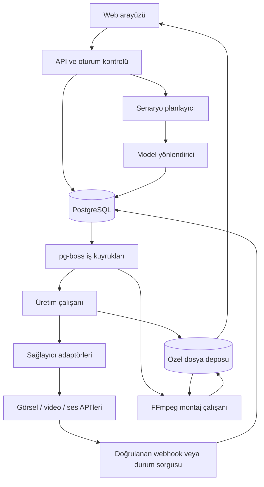

# Teknik Mimari

Tarih: 22 Ekim 2026. Durum: geliştirme öncesi önerilen tasarım.

## 1. Ürün sözleşmesi ve varsayımlar

Kullanıcı uzun bir senaryoyu Türkçe olarak girebilir. Uygulama bu metni proje, sahne ve çekimlere ayırır; referansları hazırlar; uygun modellerde üretim yapar; seçilen sonuçları ses, yazı ve geçişlerle birleştirir. Kullanıcı bütün teknik adımları tek tek yönetmek zorunda kalmaz.

İlk sürüm web tabanlı, masaüstü kullanımına öncelik veren ve mobilde izleme/düzenleme sunan kişisel bir stüdyo olarak düşünülmüştür. Kullanıcı sağlayıcı hesaplarını kendi API anahtarlarıyla bağlar. İleride ekip kullanımı mümkün olsun diye veriler baştan çalışma alanına bağlanır; ilk sürümde açık üyelik veya ticari kredi satışı gerekmez.

İlk uçtan uca hedef: 3–5 sahneli, yaklaşık 20–40 saniyelik bir proje. Bu uzunluk bir ürün limiti değil, ilk doğrulama senaryosudur. 9:16 veya 16:9 proje ayarı seçilir; montaj çıkışı için 1080p hedeflenir. Kaynak üretimin çözünürlüğü ayrıca kaydedilir: düşük çözünürlüklü bir klibi 1080p dosyaya çevirmek doğal 1080p detay üretildiği anlamına gelmez.

Otomasyon proje başında tanımlanan sınırlar içinde çalışır: bütçe, kalite tercihi, deneme sayısı, içerik revizyon yetkisi ve kabul edilebilir alternatifler. Kaynak senaryo korunur. Önemsiz teknik uyarlamalar otomatik yapılabilir; anlatıyı değiştiren düzenlemeler değişiklik olarak görünür ve önceden verilmiş yetkinin dışında uygulanmaz.

## 2. Kullanıcının gördüğü akış

1. Yeni proje: senaryo, stil, en-boy oranı, referanslar, ses dili ve bütçe.
2. Üretim planı: sahneler, çekimler, tahmini toplam süre, yöntem ve maliyet aralığı.
3. Üretim: otomatik mod veya önce storyboard kontrolü. Görseller ve çekimler tamamlandıkça önizlemeler görünür.
4. İnceleme: uygulama uygun sonucu seçer; kullanıcı istediği çekimi değiştirebilir, yeniden üretebilir veya yüklediği bir dosyayı kullanabilir.
5. Montaj: sıralama, süre, geçişler, yazılar, anlatıcı ve müzik.
6. Teslim: final video, altyazı, seçilen kaynaklar ve üretim özeti.

Ana ekranlar: Projeler; Senaryo ve plan; Storyboard; Üretim durumu; Zaman çizelgesi; Dışa aktarma; Bağlantılar ve model kataloğu. Kullanıcıya her çekimde model seçtirmek gerekmez; modelin neden seçildiği ayrıntılarda görülebilir.

## 3. Sistem yapısı

Bu bir modüler monolit tasarımıdır: iş mantığı ortak TypeScript paketlerinde bulunur; web, üretim çalışanı ve montaj çalışanı farklı süreçlerde çalışır. Her sağlayıcı için ayrı bir mikroservis kurmak gerekmez.

| Katman | İlk sürüm önerisi | Gerekçe |
| --- | --- | --- |
| Arayüz ve kısa API işlemleri | Next.js + TypeScript | Tek ürün içinde proje, storyboard, iş durumu ve ayarlar |
| Doğrulama | Zod ve sürümlü JSON sözleşmeleri | LLM çıktısını ve sağlayıcı girdilerini çalıştırmadan önce denetleme |
| Kalıcı veri | PostgreSQL + Drizzle | Proje revizyonları, iş durumları ve maliyet kayıtlarını işlemsel saklama |
| İş teslimi | pg-boss | Mevcut PostgreSQL ile kuyruk; ilk aşamada ek Redis sistemi gerektirmeme |
| Üretim çalışanı | Node.js + TypeScript | Kısa gönderim, sorgulama, içe aktarma ve denetleme işleri |
| Montaj çalışanı | Konteyner içinde FFmpeg + ffprobe | Sabit sürümlü medya işlemleri ve kaynak sınırları |
| Dosyalar | Özel S3 uyumlu nesne deposu; R2 aday | Kaynaklar, görseller, klipler, sesler ve final çıktılar |
| Kimlik | Yerleşik oturum kütüphanesi/OIDC, davetli tek sahip | İlk sürümde açık kayıt gerektirmeden erişim |
| İlerleme | Kalıcı olay kaydı ve kısa aralıklı HTTP sorgusu | Sayfa yenilendiğinde iş durumunu yeniden kurabilme |

pg-boss işleri en az bir kez teslim eder; bir işin tekrar çalışabileceği varsayılır. Kütüphanenin Drizzle adaptörü uygulama kaydı ve iş eklemeyi aynı veritabanı işlemine alabilir. Bu tasarım iç kuyruk için ayrıca genel bir outbox katmanı kurmaz. Webhook gelen kutusu ve kullanıcıya gösterilen olay kaydı ayrı ihtiyaçlardır. [pg-boss teslim davranışı](https://pgboss.io/introduction), [işlemsel adaptörler](https://pgboss.io/api/adapters).

Dağıtımda web/API, PostgreSQL, dosya deposu ve çalışanlar aynı veya yakın bölgede tutulur. Web arayüzü Vercel'de barındırılabilir; çalışanların konumu bağımsızdır. FFmpeg'i ayrı çalışan olarak seçme nedeni web isteklerinin süresine, trafiğine ve bellek kullanımına bağımlı kalmamaktır. Yerel geliştirmede konteynerlerle aynı parçalar çalıştırılır; başlangıçta yerel GPU gerekmez.

## 4. Üretim modülleri

| Modül | Sorumluluk | Çıktı |
| --- | --- | --- |
| Senaryo alımı | Ham metin, yüklenen referanslar ve proje tercihleri | Değişmez kaynak revizyonu |
| Planlayıcı | Sahne/çekim ayrımı, zamanlama, karakter ve mekân çıkarımı | Doğrulanmış üretim planı |
| İçerik ve uygunluk değerlendirmesi | Gerçek sağlayıcı kuralları ve proje izinleri açısından uygulanabilirlik | Uygun / düzenleme gerekli / inceleme gerekli / üretilemez kararı |
| Anlatım düzenleyici | Yetki dahilinde sembolik anlatım ve teknik prompt düzenleme | Orijinalle bağlantılı prompt sürümü ve değişiklik açıklaması |
| Süreklilik yönetimi | Karakter, ortam, stil, aksesuar ve referans tutarlılığı | Sürümlü referans paketi |
| Model kataloğu | Yetenek, sürüm, fiyat, erişim ve ölçüm kayıtları | Tarihli model profili |
| Yönlendirici | Uygun adayları filtreleme ve sıralama | Gerekçeli model/yöntem seçimi |
| Üretim yürütücüsü | Bağımlılıklar, işler, durum sorguları, yeniden deneme ve maliyet | İzlenebilir üretim girişimleri |
| Kalite kontrolü | Dosya geçerliliği, anlatım uyumu, süreklilik ve seçim | Kabul edilen varyant veya sınırlı düzeltme |
| Montaj ve teslim | Zaman çizelgesi, yazı, ses, geçiş, kodlama ve çıktı doğrulama | Final dosya ve teslim manifestosu |

LLM planlar ve önerir; API anahtarına, serbest ağ erişimine veya sınırsız ücretli araç çağırma yetkisine sahip olmaz. Planlama çıktısı şema, referans bütünlüğü ve üretim sınırları denetiminden sonra yürütülür. İlk sürüm için serbest dolaşan bir ajan yerine sınırları belli bir üretim hattı yeterlidir.

## 5. Sahne, çekim ve üretim stratejisi

Bir sahne birden fazla çekim içerebilir. Örneğin bir karakterin dağa dönüştüğü bir anlatım: başlangıç görüntüsü, dönüşüm ayrıntısı ve son dağ görüntüsü olarak planlanabilir. Modelin desteklediği süre ve referans türü bu parçalamayı etkiler. Tek bir uzun komutun her hareketi başarıyla üretmesi varsayılmaz.

Her çekimde şunlar tutulur: anlatı amacı; kaynak metin bölümü; karakter/mekân kimlikleri; kamera; aksiyon; hedef süre; zorunlu ve yasak görsel unsurlar; önceki/sonraki çekim bağlantısı; üretim yöntemi; ses ve yazı; referans varlıkları; kalite ölçütleri.

Yöntem seçenekleri: metinden görsel; görsel düzenleme; görselden video; doğrudan metinden video; kullanıcının yüklediği lisanslı klip; sabit görsel üzerinde sınırlı kamera hareketi; klasik yazı kartı ve montaj. Sabit görüntü hareketi, yalnızca proje buna izin veriyorsa video üretimine alternatif olabilir ve kullanıcıya bu yöntem gösterilir.

Bir görüntüden hareketli çekime geçmek veya modeli değiştirmek kalite/süreklilik garantisi değildir. Planlayıcı zor çekimleri basitleştirir; başarısızlık halinde aynı bütçe sınırları içinde yeniden değerlendirme yapılır.

## 6. Karakter ve görsel dünya tutarlılığı

Her karakter için açıklama, kıyafet, ayırt edici ayrıntılar, renkler, referans görseller ve kullanılacak sürüm kaydedilir. Mekânlar, nesneler ve görsel stil de aynı şekilde kimlik taşır. Çekimler bu kimliklere bağlanır.

Üretimden önce mümkün olduğunca bir referans paketi hazırlanır. Modelin desteklediği ölçüde karakter görselleri, başlangıç/bitiş kareleri veya önceki çekimin uygun karesi girdi olarak kullanılır. Aynı seed'in farklı modellerde aynı karakteri verdiği varsayılmaz.

Bir referans güncellendiğinde yalnızca ona bağımlı çekimler ve onların montaj çıktıları geçersizleşir. Eski çıktı saklanır; sessizce yeni projenin seçili çıktısı haline gelmez. Görsel benzerlik puanı yardımcı bir ölçümdür; karakter tutarlılığının kesin kanıtı değildir.

## 7. Model kataloğu: uygulama motorları nasıl tanıyacak?

Sağlayıcı, model ve model sürümü ayrı kayıtlardır. Aynı model ailesinin farklı servislerde bulunması ayarların, fiyatın veya sonucun aynı olduğu anlamına gelmez.

| Bilgi grubu | Örnek alanlar | Bilginin niteliği |
| --- | --- | --- |
| Kimlik | Sağlayıcı, yayıncı, model/endpoint kimliği, sürüm, API şeması | Resmî belge veya katalog |
| Yetenek | Görsel/video/ses; referans sayısı; giriş türü; süreler; oranlar; çıktı çözünürlüğü | Resmî sınırlar, adaptör testleri |
| Erişim | Hesapta kullanılabilirlik, bölge, kota, eşzamanlı iş sınırı | Hesap kontrolü ve çalışma gözlemi |
| İş yaşam döngüsü | Durum sorgusu, webhook, iptal, idempotency desteği, dosya saklama süresi | Sağlayıcı sözleşmesi |
| Fiyat | Birim, para birimi, minimum ücret, fiyat tarihi, tahmin yöntemi | Tarihli fiyat kaynağı |
| Kullanım koşulları | Lisans bağlantısı, erişim kısıtı, içerik ve veri saklama kuralları | Sürüm/tarih içeren koşul kaydı |
| Kalite | Anime, hareket, talimat uyumu, referans tutarlılığı, sahne karmaşıklığı | Kendi değerlendirme setindeki ölçümler |
| Operasyon | Başarı oranı, süre dağılımı, gerçek maliyet, hata türleri | Uygulamanın zaman aralıklı gözlemleri |

Her alanda `source`, `verified_at` ve gerekirse `expires_at` bulunur. Yeni katalog kaydı otomatik olarak üretime alınmaz. Yetenek/fiyat değişimi doğrulanır, uyumluluk testleri geçer, sonra kayıt etkinleştirilir. Çalışan üretim kendi katalog ve yönlendirme sürümüne bağlı kalır.

Kalite puanları ilk günden uydurulmaz. Başlangıçta belgelenmiş yeteneklere göre sınırlı, elle seçilmiş profiller kullanılır. Sonra aynı senaryo, aynı referans ve karşılaştırılabilir ayarlarla değerlendirme yapılır. Örneğin anime portre, iki karakter etkileşimi, stilize dönüşüm, kamera hareketi ve nesne sürekliliği ayrı görevlerdir. Her görev/model için örnek sayısı, puan dağılımı ve güven düzeyi saklanır. İlk küçük örnekler yön gösterir; kesin üstünlük ispatlamaz.

## 8. Model yönlendirme kararı

Önce zorunlu filtreler: doğru çıktı türü; gerekli referans desteği; süre ve oran; hesap erişimi; içerik uygunluğu; bütçe; güncel şema; çalışabilir servis durumu. Bu koşulları karşılamayan model puan tablosuna girmez.

Kalan adaylar için önerilen başlangıç puanı, normalize edilmiş 0–1 ölçümlerle:

`puan = 0.35 × görev_kalitesi + 0.25 × süreklilik + 0.15 × başarı_oranı + 0.15 × maliyet_uygunluğu + 0.10 × hız_uygunluğu`

Bu katsayılar ürün kararıdır; deneysel olarak doğrulanmış bir standart değildir. Kalite, dengeli ve ekonomik profillerinde ağırlıklar değişir. Maliyet ve hız için düşük değer daha yüksek uygunluk puanına dönüşür. Karşılaştırma aynı görev türündeki yakın tarihli örneklerle yapılır; örnek sayısı ve belirsizlik cezası eklenir. Ölçülmemiş modelin puanı yüksek varsayılmaz; otomatik kullanım öncesi kontrollü değerlendirme gerekir.

Her seçimle birlikte şunlar kaydedilir: gereksinimler, elenen adayların nedenleri, seçilen endpoint/sürüm, kullanılan ölçüm kümesi, fiyat kaydı, tahmini maliyet, karar güveni ve gerekçe. Kullanıcı isterse belirli bir model seçebilir; zorunlu uyumluluk kontrolleri yine çalışır.

Anime karakter için görüntü kalitesi iyi olan bir model, aynı karakterin hareketli çekiminde en iyi seçenek olmayabilir. Bu yüzden seçim proje başına tek model olarak değil, çekimdeki üretim adımı başına yapılır.

## 9. İçerik düzenleme ve sağlayıcı yanıtları

İçerik kararı yalnızca kelime veya kişi adı üzerinden verilmez. Politik hiciv, kamu figürü, tarihsel anlatı, şiddetin biçimi ve bağlamı ayrı değerlendirilir. Geçerli uygulama kuralları ve seçilen sağlayıcının belgelenmiş koşulları esas alınır; sayısal bir risk etiketi tek başına karar vermez.

Anlatım düzenleyici, örneğin açık yaralanma ayrıntısını gölge, boş mekân, ses veya nesneyle anlatma seçeneği sunabilir. Bu değişiklik özgün senaryonun üzerine yazılmaz. `original`, `proposed`, `reason`, `meaning_change` ve uygulanan izin sürümü saklanır. Maddi bir anlatım değişikliği yetki dışındaysa yalnızca ilgili çekim inceleme bekler; bağımsız uygun işler devam edebilir.

Hata sınıfları ayrı tutulur: teknik hata; kota/erişim; yanlış girdi; içerik reddi; kalite yetersizliği. İçerik reddinde aynı isteği başka bir sağlayıcıya otomatik taşıyarak filtreyi aşma akışı kurulmaz. Uygun bir anlatım revizyonu varsa yeniden değerlendirilir; çözülemeyen adım kullanıcıya açık neden ve seçeneklerle gösterilir. Teknik servis arızasında, önceden uygun bulunan alternatif ancak önceki ücretli işlemin durumu netse kullanılabilir.

## 10. Kalıcı iş akışı ve hata kurtarma

PostgreSQL üretim durumunun kaynağıdır. pg-boss işleri bu durumu ilerletmek için teslim eder. Tipik bağımlılık yapısı:

`plan → referanslar → çekim görselleri → video klipleri → kalite/seçim → montaj → doğrulama → teslim`

Bağımsız çekimler kota ve bütçe sınırları içinde paralel ilerler. Uzak servis üretimi boyunca bir HTTP isteği veya kuyruk işleyicisi açık tutulmaz. Gönderme, sorgulama, içe aktarma ve doğrulama ayrı kısa işlerdir; beklemeler sonraki işin zamanına yazılır.

| Adım durumu | Anlamı |
| --- | --- |
| `blocked` / `ready` | Bağımlılık/izin/kaynak bekliyor veya çalışabilir |
| `submitting` | Ücret rezervi ve sağlayıcı işlem kaydı oluşturuldu; gönderim aşamasında |
| `submission_unknown` | İstek ulaşmış olabilir, sonucu doğrulanamadı |
| `submitted` / `running` | Sağlayıcı iş kimliği biliniyor; takip sürüyor |
| `importing` / `validating` | Uzak çıktı oluştu; özel depoya alınıyor ve denetleniyor |
| `succeeded` | Geçerli varlık kimliği işlem içinde yayımlandı |
| `failed_retryable` / `failed_final` | Güvenli tekrar mümkün veya bu girişim sonlandı |

İptal talebi, editoryal geçerlilik ve inceleme ihtiyacı ayrı alanlardır. Böylece eski bir tamamlanma bildirimi iptal edilen veya yeni revizyonla geçersizleşen çalışmayı yeniden etkinleştiremez.

Gönderim sırası: kısa işlemde durum kontrolü, bütçe rezervi, değişmez payload özeti, mantıksal sağlayıcı işlem kimliği ve kararlı idempotency anahtarı yazılır; işlem kapatılır; ağ çağrısı yapılır; cevap kısa başka bir işlemde kaydedilir. Ağ çağrısı boyunca veritabanı kilidi tutulmaz. İşçi kiralama süresi ve fencing token ile geç kalan işçinin yeni girişimin sonucunu ezmesi engellenir.

Bu sıra dış servis ile atomik işlem sağlamaz. Sağlayıcı isteği kabul ettikten sonra bağlantı kopabilir. Böyle bir durumda yeni ücretli üretim açılmaz, rezerv serbest bırakılmaz ve başka modele geçilmez. Adaptör, gerçekten destekleniyorsa aynı anahtar ile tekrar veya istemci kimliğiyle uzlaştırma yapar. Sağlayıcının böyle bir desteği yoksa otomatik kurtarma garantisi verilemez; işlem çözümlenene kadar kullanıcı/operatör incelemesi gerekir. Tüm servislerde idempotency olduğu varsayılmaz.

Taşıma katmanı tekrarı aynı mantıksal işlemi ve payload'ı kullanır. Kullanıcının yeniden üretim isteği veya kalite için yeni varyant ise yeni ücretli girişimdir: yeni işlem kimliği ve yeni rezerv gerekir. İlk sürüm varsayılanı, çekim başına en fazla bir ek ücretli varyant önerisidir; ayar değiştirilebilir. Güvenli teknik tekrarlar için sınırlı exponential backoff ve jitter uygulanır; belirsiz gönderimler bu otomatik tekrar mekanizmasına girmez.

Webhook önce sağlayıcıya özgü doğrulamadan geçer, kalıcı gelen kutusuna yazılır ve sonra işlenir. Aynı veya sırası bozuk bildirimler durumu geriye götürmez. Gönderim cevabından önce gelen tamamlanma bildirimi saklanır ve işlem kaydıyla sonradan eşleştirilir. Bildirim imzası olmayan adaptörde payload yalnızca işaret kabul edilir; sunucu kendi kimlik bilgileriyle sağlayıcı durumunu doğrular.

İptal yeni iş gönderimini durdurur. Destekleniyorsa uzaktaki iş için de iptal istenir; iptal ücret iadesi anlamına gelmez. Geç gelen sonuç saklanabilir ama otomatik seçilmez. Yeniden başlatma, eski kayıtları topluca sıfırlamak yerine seçilen revizyonda yeni bir çalışma oluşturur.

## 11. Veri modeli ve revizyonlar

| Kayıtlar | Temel ilişki ve amaç |
| --- | --- |
| `workspaces`, `users`, `memberships` | Sahiplik ve erişim sınırı |
| `provider_connections` | Çalışma alanına ait şifreli anahtar referansı, erişim ve sağlık durumu |
| `projects`, `project_revisions` | Proje ve korunmuş kaynak senaryo/ayar revizyonları |
| `characters`, `locations`, `reference_packs` | Sürümlü karakter, mekân ve görsel dünya |
| `scenes`, `shots`, `prompt_revisions` | Kaynak metne bağlı sahne/çekim planı ve prompt değişiklikleri |
| `models`, `model_snapshots`, `model_evaluations` | Katalog, fiyat/yetenek sürümü ve göreve bağlı ölçümler |
| `production_runs`, `steps`, `step_dependencies` | Bir plan sürümünün çalışması ve sınırlı bağımlılık grafiği |
| `generation_attempts`, `provider_operations` | Ücretli varyant ile dış servis çağrısı/kimliğini ayırma |
| `assets`, `asset_lineage`, `quality_reviews` | Özel dosyalar, üretim kökeni, teknik/editoryal kontrol |
| `timelines`, `timeline_revisions`, `exports` | Seçili varlıklar, montaj manifestosu ve teslim sonucu |
| `budget_reservations`, `cost_ledger` | Tahmini yükümlülük, gerçekleşen/tahmini gider ve düzeltmeler |
| `webhook_inbox`, `run_events`, `audit_events` | Tekilleştirme, ilerleme ve önemli değişiklik geçmişi |

Tüm sahiplik taşıyan kayıtlarda `workspace_id` bulunur; ilişkiler çalışma alanı kapsamını korur. JSON alanları esnek ayarlar için kullanılabilir, ancak kritik durum, sahiplik, para ve ilişki bilgileri yalnızca serbest JSON'a bırakılmaz.

Bir çalışma; senaryo revizyonu, referans sürümleri, promptlar, model/endpoint, ayarlar, fiyat kaydı, yönlendirme politikası ve girdi varlıklarını sabitler. Girdi parmak izi yalnızca prompttan değil bu bağımlılıkların tamamından hesaplanır. Aynı girdiye ait çıktı sadece yetkili çalışma alanında yeniden kullanılabilir. Model sürümü sabitlenemiyorsa bunun yeniden üretilebilirliği sınırladığı kaydedilir.

Değişen çekim ve ona bağımlı alt işler yeni revizyonda tekrar hesaplanır; ilgisiz sahneler korunur. Kullanıcı eski bir çıktıyı bilerek seçerse seçim ayrıca kaydedilir. Bir çıktının var olması, yeni senaryoya otomatik uygun olduğu anlamına gelmez.

## 12. API sınırları

| İşlem | Önerilen uç | Davranış |
| --- | --- | --- |
| Proje oluşturma | `POST /api/projects` | Kaynak revizyonu oluşturur |
| Plan çıkarma | `POST /api/projects/:id/plans` | Üretim başlatmadan planlama işi açar; varsa LLM gideri ayrı gösterilir |
| Plan sürümü düzenleme | `PATCH /api/plans/:id` | Beklenen sürüm ile çakışma kontrolü; yeni revizyon |
| Üretim başlatma | `POST /api/production-runs` | Plan sürümü, bütçe ve otomasyon tercihlerini doğrular; `202` ve run kimliği |
| Durum ve olaylar | `GET /api/production-runs/:id`, `GET /api/production-runs/:id/events` | Kalıcı durum, seçili çıktılar, gider ve olay cursor'ı |
| Durdurma | `POST /api/production-runs/:id/cancel` | Kalıcı iptal talebi; aynı istek tekrarında yeni işlem açmaz |
| Yeni varyant | `POST /api/shots/:id/generations` | Yeni girişim, ön fiyat ve ayrı rezerv |
| Dosya yükleme | `POST /api/assets/upload-requests` | Sınırlı, süreli yükleme yetkisi |
| Montaj | `POST /api/exports` | Sabit timeline revizyonundan yeni çıktı işi |
| Bağlantı yönetimi | `POST /api/provider-connections` | Anahtarı sunucuda saklar; maliyetli test üretimi ayrıca belirtilir |
| Sağlayıcı bildirimi | `POST /api/provider-webhooks/:provider` | Ham gövde üzerinden sağlayıcıya uygun doğrulama ve inbox |

İş oluşturan uçlar çalışma alanına bağlı `Idempotency-Key` kabul eder. Aynı anahtar ve aynı payload aynı sonucu döndürür; aynı anahtar farklı payload ile gelirse çakışma hatası verir. Değişiklik uçları beklenen revizyon ile çalışır. İstemci dilediği tutarı, modeli veya dosya yolunu göndererek sunucu denetimini aşamaz.

## 13. Bütçe ve gider yönetimi

Toplam tahmin, planlama + referans görselleri + çekim görselleri + video + ses + izin verilen ek varyantlar + montaj/depodur. Uzak üretim ile altyapı gideri ayrı görünür. Birkaç sahnenin saniyesinden tam projenin fiyatı uydurulmaz; seçili model, süre, çözünürlük, adet ve fiyat kaydıyla hesap yapılır.

Gönderimden hemen önce fiyat/erişim yeniden doğrulanır. Aynı anda çalışan işler için rezervler veritabanı işlemi içinde tutulur. Kullanılabilir pay, bütçe eksi kesinleşmiş giderler ve açık taahhütlerdir; aynı girişim hem gider hem rezerv olarak iki kez sayılmaz. Para kayan noktayla saklanmaz; para birimiyle birlikte tamsayı mikro birimler kullanılır. İlk sürüm tek hesap para birimiyle çalışır; kur dönüşümü daha sonra tarihli kur kaydıyla eklenir.

Çalışma başlangıcındaki fiyat kaydı planın dayanağı olarak korunur. Gönderim öncesinde fiyat değişmişse eski tahminin üzerine yazılmaz; henüz gönderilmemiş yeni girişime güncel tarihli fiyat kaydı bağlanır ve rezerv aynı işlem içinde yeniden hesaplanır. Yeni tutar yetkilendirilmiş bütçe veya proje başında belirlenen fiyat artışı sınırını aşıyorsa gönderim durur ve inceleme gerekir. Zaten gönderilmiş veya sonucu belirsiz işlemlerin kayıtları sonradan yeni fiyatla değiştirilmez.

Kullanıcı üç değer görür: kesinleşmiş gider, henüz kesinleşmemiş taahhüt ve yeni işler için kalan pay. Başarısız veya iptal edilmiş üretimin ücret durumu ayrıca uzlaştırılır. Bilinmeyen sonuçlar rezervi tutar. Sağlayıcının nihai fatura bilgisi yoksa tutar tahmini olarak işaretlenir. Uygulama bütçesi yeni iş gönderimini sınırlar; fiyat değişikliği veya sağlayıcı tarafındaki muhasebe farkları karşısında kesin fatura tavanı garantisi değildir.

## 14. Dosyalar, anahtarlar ve erişim

API anahtarları tarayıcıya veya üretilen prompta verilmez. Üretimde yönetilen anahtar ile şifrelenir; veritabanı yalnızca şifreli değer ve anahtar sürümü tutar. Yerel ortamda ana anahtar sürüm kontrolü dışında saklanır. Loglar anahtarları, authorization başlıklarını ve imzalı URL parametrelerini maskeler. Bağlantı ekranı kayıttan sonra yalnızca kısaltılmış tanıtıcı gösterir.

Dosyalar özel depodadır. Tarayıcı ve sağlayıcı için ayrı, ihtiyaç kadar süreli yetkiler oluşturulur. R2 imzalı URL'leri belirli bir nesne/işleme geçici erişim sağlar; URL'yi bilen kişi süresi boyunca bu erişimi kullanabilir. Kuyrukta bekleme süresi hesaba katılır ve URL'ler gönderim anına yakın üretilir. [R2 imzalı URL belgeleri](https://developers.cloudflare.com/r2/api/s3/presigned-urls/).

Sağlayıcı çıktısı kalıcı arşiv sayılmaz. Uzak iş tamamlanınca süreli bağlantıdaki dosya özel depoya alınır; hash, MIME, boyut, süre, çözünürlük ve kaynak işlem kimliği kaydedilir. İçeri alma başarısızsa yeni görsel/video üretmek yerine mevcut işin dosyası yeniden alınır; bağlantı yenileme desteği adaptöre bağlıdır.

İndirilen URL'ler ve yönlendirmeler denetlenir: özel/yerel ağlara erişim kapatılır, izin verilen protokoller, boyut ve süre sınırları uygulanır. FFmpeg yalnızca hazırlanmış yerel dosyalara erişir; ağ erişimi kapalı, kaynak sınırları olan süreçte çalışır. Kullanıcı metni shell komutuna eklenmez; argüman dizileri, temizlenmiş manifestolar ve izinli medya işlemleri kullanılır.

Kaynak klip, müzik, fotoğraf ve yazı tipi için hak/sahiplik açıklaması tutulur. Model kataloğundaki lisans etiketi tek başına tüm ticari kullanım ve kişilik hakkı koşullarını açıklamaz; sağlayıcı ve model koşulları ayrı kaydedilir. Proje silme işlemi yerel veriler/depo ile sağlayıcı tarafındaki saklama durumunu ayrı raporlar.

## 15. Kalite ve son montaj

Teknik kontroller: dosyanın açılması, bozuk kare, siyah/boş çıktı, oran, süre, ses kanalları, çözünürlük ve codec. Editoryal kontroller: çekimin amacı, istenmeyen nesne/yazı, karakter/aksesuar tutarlılığı ve geçiş uyumu. Otomatik görsel değerlendirme yardımcıdır; belirsiz durumda kullanıcıya inceleme önerilir. Yeniden üretim bütçe ve deneme sayısı sınırları içindedir.

Montaj manifestosu seçili varlık kimliklerini, trim sürelerini, hızları, geçişleri, metinleri, sesleri ve çıkış ayarlarını sabitler. Yazı kartları ve daktilo gibi kesin metin gerektiren öğeler AI görseline bırakılmaz. FFmpeg filtreleri birleştirme, görüntü geçişi ve ses işlemleri sunar; bunlar sabit bir render şablonuna dönüştürülür. [FFmpeg filtre belgeleri](https://www.ffmpeg.org/ffmpeg-filters.html).

Klipler ortak fps, boyut, piksel biçimi ve ses örnekleme düzenine alınır. Geçiş örtüşmeleri toplam süre hesabına dahil edilir. Anlatıcı metninin gerçek süresi üretimden sonra ölçülür; izin verilen aralıkta görüntü süreleri ayarlanır, daha büyük uyuşmazlıkta plan revizyonu gerekir. Lisanslı müzik yüklenebilir; ses sağlayıcısı adaptörü ayrı kalır. Ses klonlama ve ileri dudak senkronu ilk kapsam dışında tutulur.

Çıktı önce geçici bir nesne anahtarına yüklenir. ffprobe ve gerektiğinde decode kontrolü, süre, akış, boyut ve ses gereksinimlerini doğrular; sonra çıktı kaydı yayımlanır. Nesne depoda doğrulanmadan arayüzde 'hazır' gösterilmez. Render tekrarı, aynı kaynak manifestosu üzerinden yapılır; kaynak üretimler baştan çağrılmaz. FFmpeg'in okuma/dönüştürme hattı için [resmî kullanım belgeleri](https://ffmpeg.org/ffmpeg.html).

## 16. Gözlemlenebilirlik ve büyüme

Her olay `workspace_id`, `run_id`, `step_id`, `attempt_id` ve varsa `provider_operation_id` ile izlenir. Operatör görünümünde takılan işler, belirsiz gönderimler, sağlayıcı hataları, ithalat gecikmeleri, masraf tutarsızlıkları ve başarısız montajlar bulunur. Prompt ve referans içerikleri varsayılan olarak genel loglara yazılmaz.

Temel göstergeler: göreve göre ilk denemede kabul oranı; kullanılabilir çıktı başına gider; sağlayıcı bekleme ve üretim süreleri; yeniden üretim oranı; kuyruk gecikmesi; dışa aktarma başarısı. Farklı türdeki görevler tek bir evrensel kalite puanında karıştırılmaz.

İlk sürümde pg-boss ve sınırlı veritabanı durum makinesi kullanılır. Çok sayıda uzun bekleme, insan sinyali, farklı üretim akışı ve canlı workflow sürüm geçişi geliştirmeyi baskılarsa Temporal gibi kalıcı yürütme sistemi yeniden değerlendirilir. Temporal geçmiş ve replay ile kurtarma sunar; dış serviste yinelenen ücretli çağrı ihtimalini kendiliğinden ortadan kaldırmaz. İki ayrı workflow sistemi aynı işin otoritesi yapılmaz. [Temporal workflow belgeleri](https://docs.temporal.io/workflows).

## 17. Uygulamadan önce kesinleştirilecek bilgiler

Başlangıç model/sağlayıcı hesapları ve API erişimleri; örnek proje başına bütçe; hedef stil ve oran; otomatik revizyon yetkisi; ses tercihi; saklama süresi; dağıtım ortamı. Bunlar tasarım hazırlığını engellemez; gerçek ücretli üretim ve dağıtım öncesinde ayar/erişim olarak tamamlanır.

İlk model listesinin ve fiyatının yalnızca internet belgeleriyle kesinleştiği söylenemez. Hesabın erişimi, küçük deneme sonuçları ve istenen içerikteki başarı ayrıca doğrulanır.

## 18. İlk sağlayıcı bağlantıları ve doğrulanmış API farkları

Önerilen sıra: ana görsel/video adaptörü olarak fal; ikinci, doğrudan video adaptörü olarak Runway; daha sonra seçilmiş model ihtiyacı oluşursa Replicate. Bu sıra kalite üstünlüğü iddiası değil, başlangıç entegrasyonlarını sınırlayan bir mimari tercihtir. İlk sağlayıcıda uçtan uca akış çalışmadan ikinci bağlantı genişletilmez.

| Bağlantı | İlk kullanım | Adaptöre etkisi |
| --- | --- | --- |
| fal | Seçilmiş birkaç görsel ve görselden-video endpointi | Kalıcı istek kimliği ve kuyruk sorguları; sağlayıcıya özgü webhook doğrulama; model başına giriş eşleme |
| Runway | İkinci video seçeneği ve kontrollü karşılaştırma | Görev kimliğiyle polling; gerekli API sürüm başlığı; hesaba/model türüne bağlı erişim ve sınırlar |
| Replicate — sonraki aşama | Belirli bir model ailesi için ek erişim | Prediction yaşam döngüsü; farklı webhook protokolü; hızlı dosya arşivleme |

fal'ın asenkron kuyruk akışı `request_id` ve durum/sonuç/iptal bağlantıları döndürür. Adaptör dönen bağlantıları kullanır. Kuyruktaki `COMPLETED` durumu tek başına geçerli medya kanıtı sayılmaz; hata ve gerçek sonuç ayrıca incelenir. [fal asenkron üretim](https://fal.ai/docs/documentation/model-apis/inference/queue).

fal webhook'ları ED25519/JWKS ile doğrulanır; genel bir HMAC doğrulayıcısı bütün sağlayıcılara uygulanamaz. Ham gövde, istek kimlikleri ve zaman bilgisi doğrulama sözleşmesine göre işlenir. [fal webhook belgeleri](https://fal.ai/docs/documentation/model-apis/inference/webhooks).

fal'ın model araması keşif ve şema bilgisi sağlar; belgelerindeki ilgili/trend sırası kalite veya gecikme sıralaması değildir. Bu nedenle uygulamadaki anime/hareket/tutarlılık puanları bu listeden türetilmez. [fal model arama API'si](https://fal.ai/docs/platform-apis/v1/models).

fal istek geçmişi ve medya ömrü için ayrı kontroller sunar. İstek girdi/çıktı kaydını kapatma ayarı bütün tarafların tüm loglarını sildiği anlamına gelmez. Saklama tercihi, endpoint ve sağlayıcı koşulları birlikte değerlendirilir. [fal veri saklama](https://fal.ai/docs/documentation/model-apis/media-expiration).

Runway için incelenen belgelenmiş temel akış görev oluşturma ve `GET /v1/tasks/{id}` ile takiptir. İlk adaptör polling kullanır; resmî rehber en az beş saniye aralık, jitter ve hatalarda artan bekleme önerir. Genel üretim webhook desteği varsayılmaz. [Runway API kullanımı](https://docs.dev.runwayml.com/guides/using-the-api/).

Runway çıktı bağlantılarının API erişiminden itibaren 24–48 saat içinde süresi dolar. Bu yüzden sonuçlar özel depoya alınmadan çekim teslim edilmiş sayılmaz. [Runway çıktı biçimleri ve saklama](https://docs.dev.runwayml.com/assets/outputs/). Kapasite ve harcama limitleri hesabın katmanına bağlıdır; bu belgede sabit eşzamanlı üretim sayısı taahhüt edilmez. [Runway kullanım katmanları](https://docs.dev.runwayml.com/usage/tiers/).

Replicate API üretimlerinde girdi, çıktı ve loglar varsayılan olarak bir saat sonra kaldırılır. Sonraki entegrasyonda tamamlanma olayı dosya arşivini gecikmeden tetiklemelidir. [Replicate veri saklama](https://replicate.com/docs/topics/predictions/data-retention/). Webhook doğrulaması kendi imza başlıkları ve HMAC-SHA256 protokolüne dayanır. [Replicate webhook doğrulama](https://replicate.com/docs/topics/webhooks/verify-webhook).

Bu belgeler 22 Ekim 2026 tarihinde kontrol edildi. API erişimi, fiyatlar, hesap kotaları ve model bazlı kullanım koşulları geliştirme denemesinde tekrar doğrulanır. İncelenen genel dokümanlardan bütün sağlayıcılarda güvenli create-idempotency desteği olduğu sonucu çıkarılmamıştır; adaptör bu özelliği doğrulanana kadar desteklenmiyor kabul eder.
